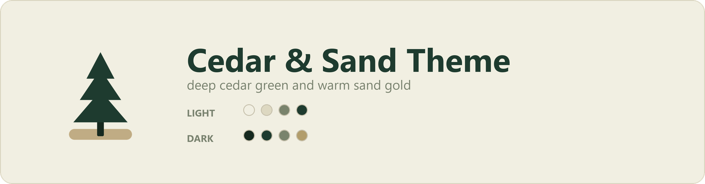
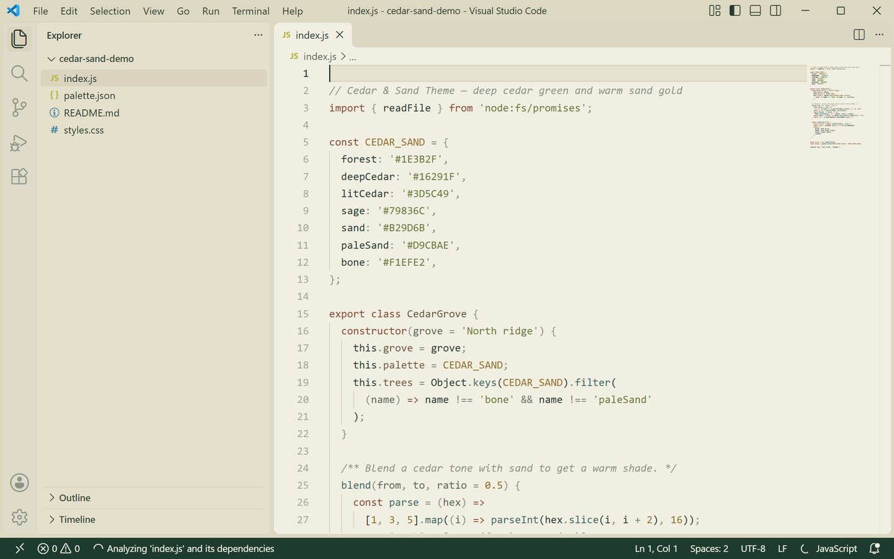
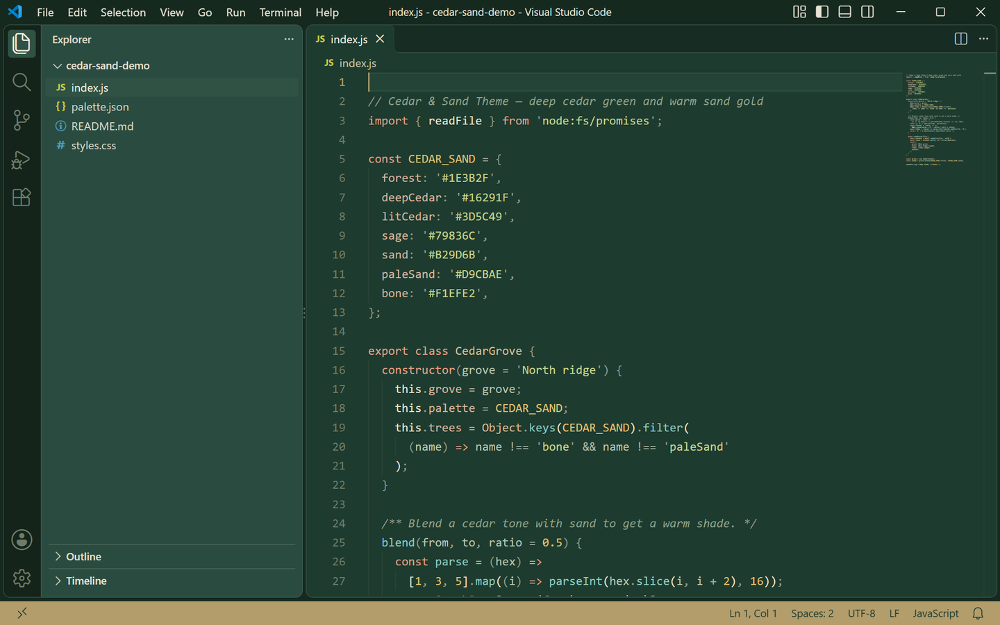

<div align="center">



# Cedar & Sand Theme

**Deep cedar green and warm sand gold — an earthy VS Code theme in a light and a dark cut.**

[](https://github.com/vaxicy/cedar-sand-theme)
[](https://code.visualstudio.com/)
[](#two-cuts)
[](LICENSE)
[](https://code.visualstudio.com/)
[](https://github.com/vaxicy/cedar-sand-theme)

[English](#-english) · [简体中文](#-简体中文)

</div>

---

## 🇬🇧 English

**Cedar & Sand Theme** is an earthy palette built from four colours: deep cedar `#1E3B2F`,
warm sand `#B29D6B`, cedar sage `#79836C` and bone `#F1EFE2`. It ships as two cuts of the
same landscape — a bone-paper daylight version and a midnight-cedar version with a sand
status bar.

<a id="two-cuts"></a>

### Two cuts

| Cut | Surfaces | Accent | Best for |
|---|---|---|---|
| **Light** | bone `#F1EFE2`, sand-shadow chrome | forest `#1E3B2F` status bar + sand `#B29D6B` buttons | daytime, long reading |
| **Dark** | cedar `#1E3B2F`, deep cedar `#16291F` chrome | sand `#B29D6B` status bar + buttons | night, low-light rooms |

### Screenshots

Both are real VS Code windows running the shipped theme.

#### Light


#### Dark


### Install

1. Open **Extensions** in VS Code (`Ctrl+Shift+X`).
2. Search **Cedar & Sand Theme** and click **Install**.
3. `Ctrl+K Ctrl+T` → pick **Cedar & Sand Theme Light** or **Dark**.

Or from a VSIX:

```bash
code --install-extension cedar-sand-theme-1.0.0.vsix
```

### Set it in settings.json

```jsonc
{
  "workbench.colorTheme": "Cedar & Sand Theme Dark",

  // optional: keep the sand status bar but tint one surface
  "workbench.colorCustomizations": {
    "activityBar.background": "#1A3329"
  }
}
```

### What's tuned

- **144 hand-placed UI colours** per cut, plus light/dark syntax tokens and semantic tokens.
- **De-collided bases**: the light bone sits clear of the crowded near-white band, and the
  cedar base is a warmer, deeper green than the other forest themes on the market.
- **Sand carries the accent**: the status bar is the loudest element in both cuts, so you can
  tell the two variants apart from across the room.
- No neon. Syntax colours are earthy — rust keywords, olive strings, teal functions, ochre
  numbers.

The complete colour table lives in [`COLOR-SPEC.md`](COLOR-SPEC.md).

### Palette

Every cut carries its own colour card — surfaces first, accent last.

**Light cut**

| Swatch | Role | Hex |
|---|---|---|
| 🦴 | Bone (editor) | `#F1EFE2` |
| 🏖️ | Sand shadow (chrome) | `#DDD8C1` |
| 🌿 | Cedar sage | `#79836C` |
| 🌲 | Cedar / forest (status bar) | `#1E3B2F` |

**Dark cut**

| Swatch | Role | Hex |
|---|---|---|
| 🌑 | Deep cedar (chrome) | `#16291F` |
| 🌲 | Cedar (editor) | `#1E3B2F` |
| 🌿 | Cedar sage | `#79836C` |
| 🏜️ | Warm sand (status bar) | `#B29D6B` |

---

## 🇨🇳 简体中文

**Cedar & Sand Theme** 是一套「土系」配色的 VS Code 主题，只用四个颜色构成：深雪松
`#1E3B2F`、暖沙 `#B29D6B`、雪松灰绿 `#79836C`、骨白 `#F1EFE2`。同一片风景提供两个切面——
骨白纸感的浅色版，和深夜雪松色配沙金状态栏的深色版。

### 两个切面

| 切面 | 表面色 | 强调色 | 适合 |
|---|---|---|---|
| **Light（浅色）** | 骨白 `#F1EFE2` + 沙影工具栏 | 林绿状态栏 `#1E3B2F` + 沙金按钮 `#B29D6B` | 白天、长时间阅读 |
| **Dark（深色）** | 雪松 `#1E3B2F` + 深雪松 `#16291F` 工具栏 | 沙金状态栏与按钮 `#B29D6B` | 夜晚、弱光环境 |

### 截图

以下两张均为加载了对应变体的真实 VS Code 窗口。

#### Light（浅色）


#### Dark（深色）


### 安装

1. 在 VS Code 中打开 **扩展**（`Ctrl+Shift+X`）。
2. 搜索 **Cedar & Sand Theme** 并点击 **安装**。
3. `Ctrl+K Ctrl+T` → 选择 **Cedar & Sand Theme Light** 或 **Dark**。

或使用 VSIX 安装：

```bash
code --install-extension cedar-sand-theme-1.0.0.vsix
```

### 在 settings.json 中指定

```jsonc
{
  "workbench.colorTheme": "Cedar & Sand Theme Dark",

  // 可选：保留沙金状态栏，只微调某一处
  "workbench.colorCustomizations": {
    "activityBar.background": "#1A3329"
  }
}
```

### 调校细节

- 每个切面 **144 个手工设定的 UI 颜色**，外加深 / 浅两套语法 token 与语义 token。
- **底色避撞**：浅色的骨白从拥挤的「近白」色带里偏移开；深色的雪松比市面上其他森林绿主题更暖、更深。
- **沙金承担强调**：两个切面里状态栏都是最醒目的元素，隔着房间也能分辨浅色 / 深色。
- 不用荧光色。语法色走土系——铁锈红关键字、橄榄绿字符串、青绿函数、赭黄数字。

完整配色表见 [`COLOR-SPEC.md`](COLOR-SPEC.md)。

### 色板

每个切面各有一张色卡——从表面色到强调色。

**浅色切面**

| 色块 | 角色 | 色值 |
|---|---|---|
| 🦴 | 骨白（编辑区） | `#F1EFE2` |
| 🏖️ | 沙影（工具栏） | `#DDD8C1` |
| 🌿 | 雪松灰绿 | `#79836C` |
| 🌲 | 雪松 / 林绿（状态栏） | `#1E3B2F` |

**深色切面**

| 色块 | 角色 | 色值 |
|---|---|---|
| 🌑 | 深雪松（工具栏） | `#16291F` |
| 🌲 | 雪松（编辑区） | `#1E3B2F` |
| 🌿 | 雪松灰绿 | `#79836C` |
| 🏜️ | 暖沙（状态栏） | `#B29D6B` |

---

## License

Non-Commercial License — see [LICENSE](LICENSE).
